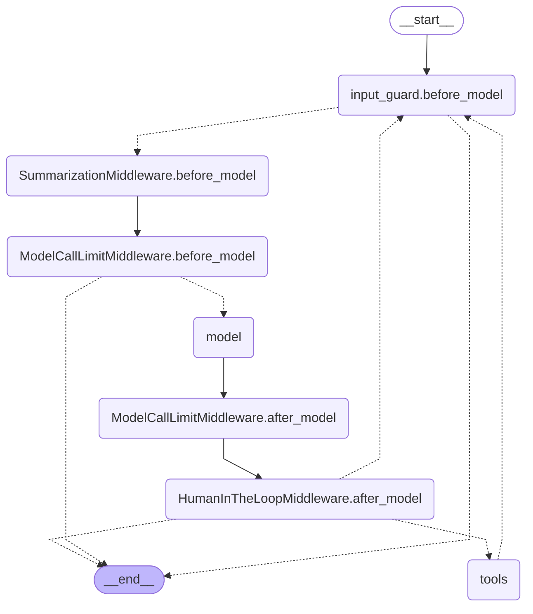
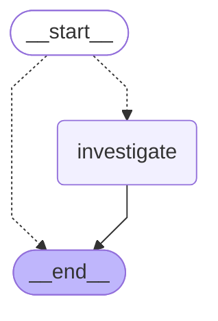

# 에이전트 그래프

`uv run python scripts/export_graphs.py`로 코드에서 생성한 그림입니다. 직접 고치지 마세요.

## Supervisor (create_agent + 미들웨어)

`docs/graph_supervisor.mmd`

## 병렬 조사 (Send fan-out)

`docs/graph_fanout.mmd`

## 전체 구조 (Supervisor → 도구 → 전문 에이전트 → 하위 도구)

`docs/graph_system.mmd`

```mermaid
flowchart TD
    U(["사용자"]) --> S{{"Supervisor"}}
    S --> t_predict_failure["predict_failure"]
    t_predict_failure --> b_predict_failure[("LightGBM 모델<br/>models/lgbm.pkl")]
    S --> t_investigate_machines["investigate_machines"]
    t_investigate_machines --> a_investigate_machines(["조사 에이전트 ×N<br/>(병렬 fan-out)"])
    a_investigate_machines --> a_investigate_machines_get_sensor_trend["get_sensor_trend"]
    a_investigate_machines --> a_investigate_machines_get_error_logs["get_error_logs"]
    a_investigate_machines --> a_investigate_machines_get_maintenance_history["get_maintenance_history"]
    a_investigate_machines --> a_investigate_machines_find_similar_failures["find_similar_failures"]
    a_investigate_machines --> a_investigate_machines_search_manual["search_manual"]
    a_investigate_machines --> a_investigate_machines_recall_machine_memory["recall_machine_memory"]
    S --> t_ask_planner_agent["ask_planner_agent"]
    t_ask_planner_agent --> a_ask_planner_agent(["계획 에이전트"])
    a_ask_planner_agent --> a_ask_planner_agent_rank_maintenance["rank_maintenance"]
    a_ask_planner_agent --> a_ask_planner_agent_check_parts_stock["check_parts_stock"]
    a_ask_planner_agent --> a_ask_planner_agent_draft_work_order["draft_work_order"]
    a_ask_planner_agent --> a_ask_planner_agent_draft_purchase_request["draft_purchase_request"]
    S --> t_ask_data_agent["ask_data_agent"]
    t_ask_data_agent --> a_ask_data_agent(["데이터 에이전트"])
    a_ask_data_agent --> a_ask_data_agent_sql_db_list_tables["sql_db_list_tables"]
    a_ask_data_agent --> a_ask_data_agent_sql_db_schema["sql_db_schema"]
    a_ask_data_agent --> a_ask_data_agent_run_sql_guarded["run_sql_guarded"]
    S --> t_ask_report_agent["ask_report_agent"]
    t_ask_report_agent --> a_ask_report_agent(["리포트 에이전트"])
    a_ask_report_agent --> a_ask_report_agent_read_evidence["read_evidence"]
    a_ask_report_agent --> a_ask_report_agent_save_report["save_report"]
    S --> t_submit_work_order["submit_work_order"]
    t_submit_work_order --> b_submit_work_order[("사람 승인(HITL) 후<br/>outputs/registered")]
    S --> t_submit_purchase_request["submit_purchase_request"]
    t_submit_purchase_request --> b_submit_purchase_request[("사람 승인(HITL) 후<br/>outputs/registered")]
    S --> t_replan_maintenance["replan_maintenance"]
    t_replan_maintenance --> b_replan_maintenance[("조건 해석(LLM) → rank 재계산(코드)<br/>→ 초안 v2+ (outputs/plans·drafts)")]
    S --> t_get_engineer_feedback["get_engineer_feedback"]
    t_get_engineer_feedback --> b_get_engineer_feedback[("장기 기억<br/>(InMemoryStore, 엔지니어 피드백)")]
    classDef hitl fill:#ffe9d6,stroke:#d9822b
    class t_submit_work_order hitl
    class t_submit_purchase_request hitl
```

